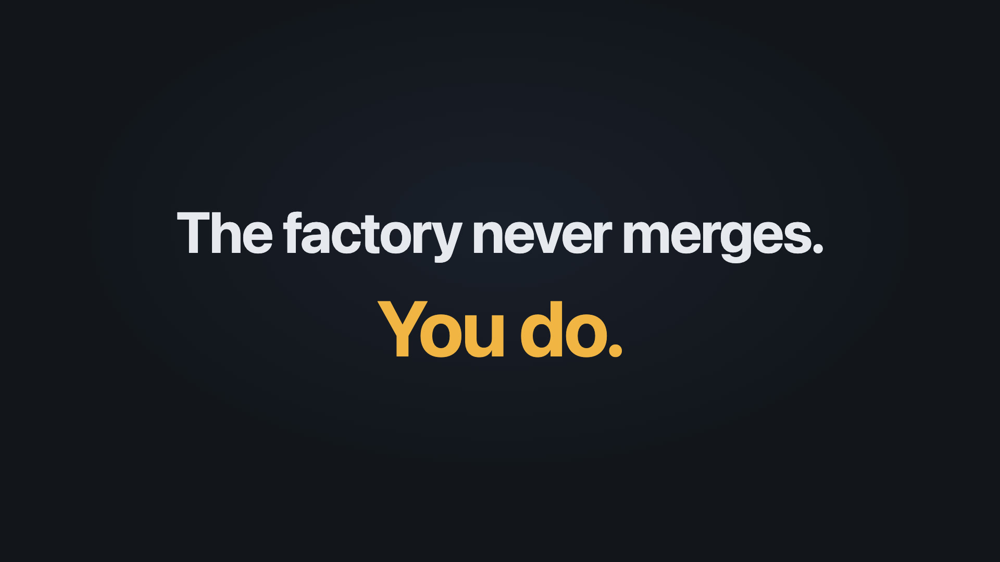

# The AI Code Factory in 20 seconds

[Watch the video](ai-code-factory.mp4) (1920×1080, 20 s, with sound).

One command gets you a whole dev team: a spec writer, a builder, four
reviewers and an approver. The video shows them on a real job from the
[example todo app](https://github.com/Pkalliagkas1989/AI_Code_Factory/tree/example/todo-app/examples),
where the code reviewer caught a bug the tests missed, and ends where every job
ends: the factory recommends, and you merge.

| File | What it is |
| --- | --- |
| `ai-code-factory.mp4` | The video |
| `ai-code-factory.jpg` | Its cover image |
| `share-copy.txt` | A ready-made post to share it with |
| `storyboard.md` | The plan: angle, scenes, timing and colours |
| `source/` | The animated page the video was recorded from, the recording script and the music generator |

Every number in the video comes from the real record of job 002 in the todo
app. The music is an original track generated for it.
