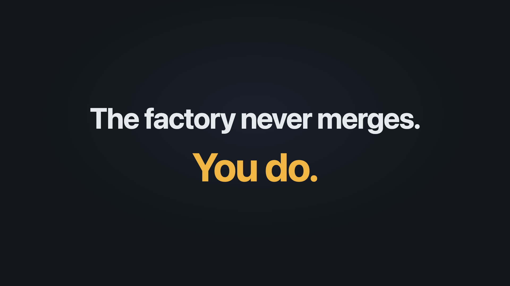

# The AI Code Factory in 20 seconds

[](ai-code-factory.mp4)

[Watch the video](ai-code-factory.mp4) (1920×1080, 20 s, with sound).

One command gets you a whole dev team: a spec writer, a builder, four
reviewers and an approver. The video shows them on a real job from the
[example todo app](https://github.com/Pkalliagkas1989/AI_Code_Factory/tree/example/todo-app/examples),
where the code reviewer caught a bug the tests missed, and ends where every job
ends: the factory recommends, and you merge.

| File | What it is |
| --- | --- |
| `ai-code-factory.mp4` | The video |
| `ai-code-factory.jpg` | Its cover image |
| `share-copy.txt` | A ready-made post to share it with |
| `storyboard.md` | The plan: angle, scenes, timing and colours |
| `source/` | The animated page the video was recorded from, the recording script and the music generator |

Every number in the video comes from the real record of job 002 in the todo
app. The music is an original track generated for it.

To record the source locally, use Node.js 22 or newer and the default macOS
Google Chrome installation:

```sh
node pitch/source/capture.mjs /tmp/pitch-frames 30 20
node pitch/source/capture.mjs /tmp/pitch-stills 30 20 0,5,10,20
node --test pitch/source/test-capture.mjs
```

FPS and duration must be finite positive numbers, producing 1–18,000 frames;
still times must lie between zero and the specified duration, with at most
18,000 entries. Defaults remain 30 fps and 20 seconds. The recorder launches
Chrome with a unique temporary profile and an automatically allocated local
CDP port, creates its own page, and removes the profile when it finishes or
fails. Startup and each CDP operation have a 10-second timeout. SIGINT/SIGTERM
also trigger cleanup; Chrome receives SIGTERM, then SIGKILL if needed. Forced
termination of the recorder (for example SIGKILL or machine shutdown) cannot
run cleanup. Frames already written remain available after a failed capture.
